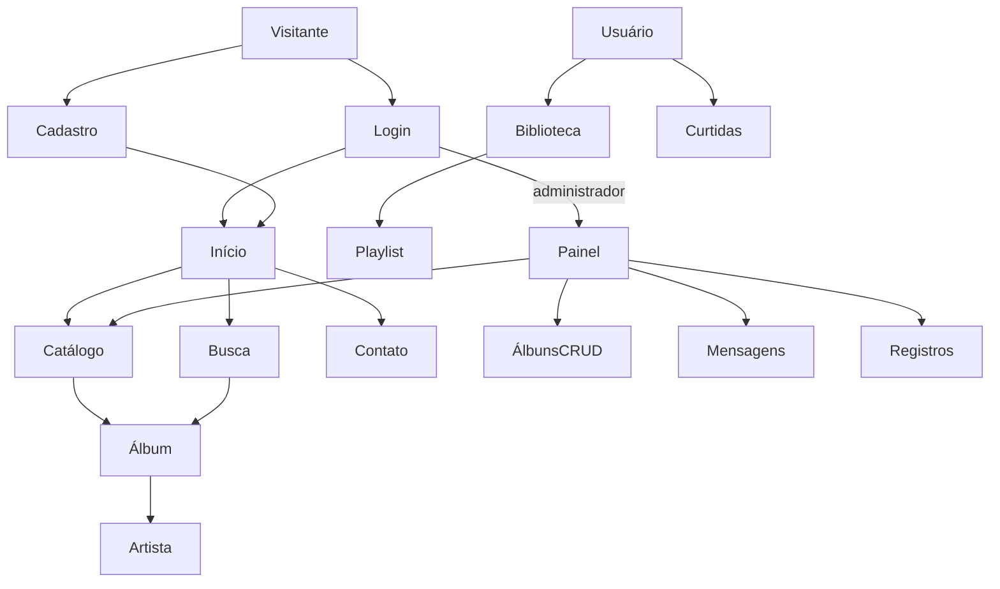
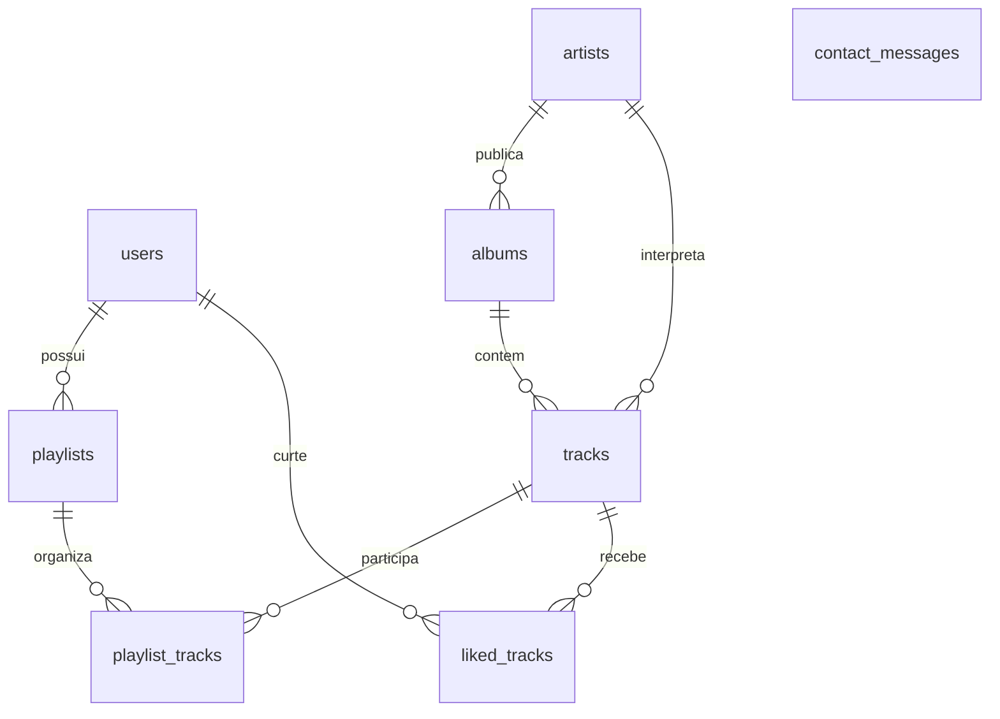

# Onda Music

Projeto de Desenvolvimento Web I do Grupo 2: **Cauan Riffel, Giovani Pott e Vicente Pilonetto**. Onda é um mock educacional de streaming inspirado no Spotify, sem vínculo com a empresa. O catálogo de exemplo usa artistas fictícios e tons curtos gerados para o projeto.

**Parte 2 (frontend estático):** [GitHub Pages](https://vicente-pilonetto.github.io/DWI-Onda-music/). **Parte 3 (PHP + MariaDB):** hospedagem prevista em `onda.papotorto.com.br` (ainda não publicada); até lá, rode localmente com Docker conforme abaixo.

## Casos de uso

| Perfil | O que pode fazer |
| --- | --- |
| Visitante | Navegar pelo catálogo, artistas e álbuns; buscar músicas; enviar mensagem pelo formulário de contato; criar conta ou entrar. |
| Usuário autenticado | Reproduzir faixas, criar e organizar playlists, curtir músicas. |
| Administrador | Entrar no painel, cadastrar/editar álbuns, remover álbuns sem faixas, ler/marcar/excluir mensagens de contato e consultar registros de usuários. |

Regras principais: só o dono acessa e altera suas playlists; uma faixa não se repete na mesma playlist; a reprodução exige sessão; somente administradores alteram o catálogo; um álbum com faixas não pode ser excluído pelo painel; cada email envia no máximo 3 mensagens de contato a cada 24 horas. Todas são validadas no PHP, independentemente do JavaScript.

## Mapa do site



O mapa editável e os wireframes desktop/mobile estão em [docs/mapa-site.drawio](docs/mapa-site.drawio) e [docs/wireframes.drawio](docs/wireframes.drawio). São rascunhos montados depois da implementação para revisão do grupo; precisam ser conferidos e usados na entrega SBC conforme o enunciado. O relatório completo de requisitos e limitações está em [docs/REQUISITOS.md](docs/REQUISITOS.md), e o planejamento de referência em [docs/PLANEJAMENTO.md](docs/PLANEJAMENTO.md).

## Tecnologias

PHP 8.2+ sem framework, PDO com MariaDB, HTML/CSS/JavaScript sem framework, módulos ES e Docker Compose com Nginx, PHP-FPM e MariaDB. A interface principal é uma SPA com rotas por hash; inclui também páginas PHP compartilhadas e um painel administrativo.

## Rodar localmente

Requer Docker Compose e Python 3. Clone o repositório, configure o `.env` e suba os serviços:

```sh
git clone https://github.com/Vicente-PIlonetto/DWI-Onda-music.git
cd DWI-Onda-music
python3 scripts/configure.py
docker compose up -d --build
```

Abra [http://localhost:8088](http://localhost:8088). O entrypoint executa migrations e seed. Para repetir manualmente:

```sh
docker compose exec php-fpm php scripts/migrate.php
docker compose exec php-fpm php scripts/seed.php
```

Para testar o importador com arquivos locais, copie os áudios para `storage/audio/` e execute:

```sh
docker compose exec php-fpm php scripts/import_tracks.php --dir=/app/storage/audio --license="Licença informada pelo grupo"
```

O importador lê tags ID3, mantém os arquivos em `storage/audio/` e usa o caminho/hash para evitar duplicatas.

O `.env` local é criado com senhas aleatórias e fica ignorado pelo Git. As contas de exemplo usam `admin@example.test` e `aluno@example.test`; consulte `SEED_ADMIN_PASSWORD` e `SEED_USER_PASSWORD` no `.env` local para as respectivas senhas. O professor precisa receber as credenciais de demonstração em canal privado, caso sejam solicitadas. Alterar o `.env` não troca a senha de uma conta já criada.

Para encerrar, use `docker compose down`. Os dados ficam nos volumes; `docker compose down -v` remove o banco. A porta padrão é 8088 e pode ser configurada por `APP_PORT`. Em hospedagem HTTPS, defina `SESSION_SECURE=1`.

## Parte 3: páginas PHP

| Endereço | O que demonstra |
| --- | --- |
| `/catalogo.php` | Listagem pública dinâmica dos álbuns cadastrados no painel, com busca, filtro por ano e paginação (`?pagina=`) via **GET**. |
| `/contato.php` | Formulário **POST** com validação no servidor, sanitização (`filter_var`, `htmlspecialchars`), CSRF, mensagens de sucesso/erro e dados mantidos em caso de erro. Grava em `contact_messages`. |
| `/admin/` | CRUD de álbuns (login com `$_SESSION`, `password_hash`/`password_verify`, redirecionamento com `header` sem login). |
| `/admin/messages.php` | Registros do formulário de contato: listar, filtrar não lidas, marcar como lida e excluir. |
| `/admin/users.php` | Cadastros recebidos pelo formulário de criação de conta. |

Cabeçalho, menu e rodapé ficam em `backend/views/` (`header.php`, `menu.php`, `footer.php`) e são incluídos com `require` pela SPA, pelas páginas públicas e pelo painel. O acesso a dados e as regras de negócio ficam em `backend/src/Repositories/` e `backend/src/Controllers/`, separados do HTML. O script SQL de criação está em `backend/migrations/` (`001_schema.sql` e seguintes).

**Usuário de teste do painel:** criado pelo seed com `SEED_ADMIN_EMAIL`/`SEED_ADMIN_PASSWORD` do `.env`. Informe o email e a senha de teste no envio da Parte 3 pelo Classroom (não versionar a senha).

## Parte 2: frontend e GitHub Pages

A versão estática cobre Início, Catálogo, Busca, Álbum, Artista, Contato, Login, Cadastro, Biblioteca, Playlist, Curtidas, entrada administrativa, Painel de álbuns, Mensagens e Cadastros. O botão ☀/☾ no topo alterna entre tema claro e escuro, e a escolha fica salva no `localStorage`. Use `demo@onda.test` para o perfil comum ou `admin@onda.test` para o painel; qualquer senha com pelo menos 12 caracteres passa pela validação visual. Os dados são fictícios e as alterações ficam no `localStorage` deste navegador. O player reproduz tons gerados localmente. Essa demonstração não usa PHP nem banco.

Para executar somente o frontend com Docker Compose:

```sh
docker compose -f docker-compose.frontend.yml up -d --build
```

Abra [http://localhost:8089](http://localhost:8089). Encerre com `docker compose -f docker-compose.frontend.yml down`. `FRONTEND_PORT` altera a porta.

O exportador produz os mesmos arquivos para GitHub Pages:

```sh
python3 scripts/export_pages.py --output /tmp/onda-pages
```

A workflow `.github/workflows/pages.yml` publica essa pasta quando houver push na `main` ou execução manual. Nas configurações do repositório, escolha **GitHub Actions** como origem do Pages. Depois da primeira execução, abra a URL acima e confira as telas no celular e no desktop. O domínio próprio informado acima não substitui a URL do Pages.

## Importação e dados

`data/catalog.csv` guarda os metadados versionáveis. Áudios e capas locais ficam em `storage/audio/` e `storage/covers/`, fora do Git. Instruções de origem, licença e arquivos estão em [data/README.md](data/README.md); créditos em [ATTRIBUTIONS.md](ATTRIBUTIONS.md).

```sh
cp /caminho/faixa.mp3 storage/audio/
docker compose exec php-fpm php scripts/import_tracks.php \
  --dir=/app/storage/audio --csv=/app/data/meu_catalogo.csv
```

Use um CSV com as colunas de `data/catalog.csv`. Metadados preenchidos no CSV têm prioridade sobre tags lidas com getID3. O importador é idempotente. Para baixar origens HTTPS autorizadas, use `sh scripts/download_audio.sh` e revise os créditos com `python3 scripts/attributions.py`.

No site, o dono de cada playlist pode enviar uma capa JPEG, PNG ou WebP de até 3 MB, trocar a imagem ou removê-la. A validação acontece no PHP; os arquivos ficam em `storage/covers/`, fora do Git. Para repetir o teste local com as faixas já importadas, mantenha o arquivo extraído em `storage/audio/_local-import/` e rode o mesmo comando `import_tracks.php --dir=/app/storage/audio/_local-import --license='Licença de uso local declarada pelo usuário; teste local, não redistribuir'`. Esse áudio não faz parte dos CSVs nem dos pacotes.

## Banco de dados



As migrations SQL usam MariaDB/InnoDB. As chaves estrangeiras removem relações dependentes em cascata; faixas impedem excluir um álbum ocupado. Índices atendem relações e busca textual; listagens usam cursor. O áudio passa pelo Nginx via `X-Accel-Redirect`, com suporte a HTTP Range.

## Validar

Com Docker em execução:

```sh
python3 tests/integration.py
python3 tests/admin.py
python3 tests/importer.py
python3 tests/playlist_cover.py
python3 tests/contact.py
python3 scripts/check_repository.py
```

Os testes criam e removem registros temporários. A verificação de repositório detecta segredos conhecidos e arquivos acima de 5 MB; revise o resultado antes de publicar.

## Escalabilidade

O MariaDB, os índices e a paginação por cursor dão suporte a catálogos maiores. O Nginx serve os arquivos de áudio diretamente e permite seek por Range. PHP com PDO organiza API, controllers e repositórios. A autenticação atual usa sessão PHP, então a API não é totalmente stateless; para escalar múltiplas instâncias, a próxima etapa seria compartilhar sessões com Redis. Outras evoluções possíveis: fila para conversão com ffmpeg, réplicas de leitura e CDN.

Os pedidos feitos a ferramentas de IA estão em [PROMPTS.md](PROMPTS.md), com ferramenta, parte do trabalho, prompt e como a resposta foi usada.
